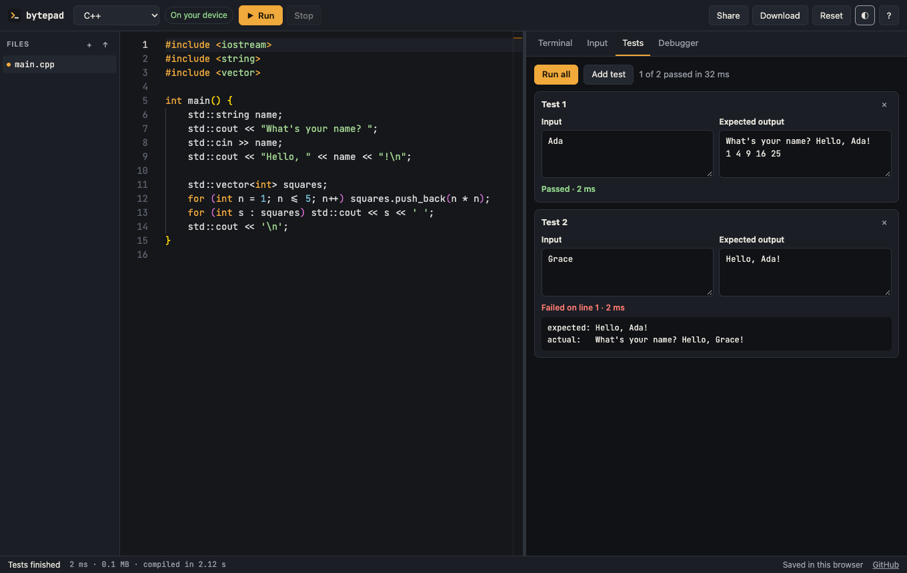

# Bytepad

**An open-source online compiler that runs your code on your own device.**
No signup, no ads and no server to pay for. Programs can really stop and wait for you to type.

**[Open Bytepad](https://chinmay6537.github.io/bytepad/)**



## Why it exists

Most online compilers send code to a server, run it, and return the output. That design causes the usual
frustrations: ads and account gates to pay for servers, input that has to be typed before the program starts,
and free services that shrink or close. In 2026 alone, the public Piston API
[went whitelist-only](https://github.com/engineer-man/piston#public-api), and Replit was
[reported to have removed its free Starter plan](https://pricingsaas.com/news/article/replit-kills-its-free-starter-plan-pushes-free-users-onto-quota-capped-free-mode).

Bytepad runs Python, C, C++, JavaScript and TypeScript **inside your browser** using WebAssembly, on a
static site that costs nothing to host. See [what the research found](docs/RESEARCH.md).

## Features

| Feature | What it means |
| --- | --- |
| **Live input** | `scanf`, `cin` and `input()` pause until you type in the terminal. Prompts appear first, as they should. |
| **Private by default** | Browser languages never upload your code. A badge always shows where the code will run. |
| **Works offline** | After the first run of a language, it keeps working with no connection. It can also be installed as an app. |
| **Python debugger** | Breakpoints, step over, into and out, live variables and the call stack. |
| **Test cases** | Save input and expected-output pairs, run them all, and see the first line that differs. |
| **Multi-file projects** | Headers, modules, uploads, and a choice of which file runs first. |
| **File I/O** | `fopen` and `open` work, and files your program writes appear in the sidebar. |
| **Links that don't expire** | The project lives in the link itself. Nothing is stored on a server, and no login is needed. |
| **Clickable errors** | Errors are underlined in the editor, and locations in the terminal jump to the line. |
| **Run details** | Run time (excluding time spent waiting for your input), memory, compile time and exit code. |
| **Student-friendly C/C++** | `<bits/stdc++.h>` and basic `<conio.h>` work, and crashes are explained in plain English. |
| **Editor** | Monaco (the editor behind VS Code), light and dark themes, autosave, and a phone layout. |

## Languages

| Runs in your browser | Runs on [Wandbox](https://wandbox.org) (cloud) |
| --- | --- |
| Python, C, C++, JavaScript, TypeScript | Java, Go, Rust, C#, Ruby, PHP, Bash, Lua, Perl, Haskell, Scala, R, Zig, SQL (SQLite), Pascal |

Cloud languages send your code to Wandbox, a free third-party service, when you press Run. You can
[point Bytepad at your own Piston server](docs/ARCHITECTURE.md#cloud-languages) instead.

## Known limitations

- **C++ exceptions can't be caught in the browser.** The bundled C++ runtime is built without exception support, so
  a `throw` stops the program with an explanation. Turn on **Compile on Wandbox with GCC** in the Input tab for exceptions, threads or GCC-only features.
- **No threads or sockets** in browser-run C and C++.
- **Cloud languages can't take live input.** Enter it in the Input tab before pressing Run.
- **The debugger is Python only.**
- **Some C mistakes don't crash the way they do natively.** In WebAssembly, address 0 is valid memory, so reading a null pointer can return 0 instead of a segmentation fault. Integer division by zero is undefined behaviour and may also print a value. Don't rely on a browser run to catch these.
- **`getch()` waits for Enter**, because terminal input is line based.
- **The first C or C++ run downloads the compiler** (about 27 MB compressed), then it's cached. Python's core is about 6 MB.
- **Autocomplete is richest for JavaScript and TypeScript.** Other languages get syntax highlighting and word-based suggestions.
- **Python packages:** pure Python and [Pyodide-built packages](https://pyodide.org/en/stable/usage/packages-in-pyodide.html) such as numpy load on import. They need a connection the first time. Desktop windows, such as `plt.show()`, aren't supported.
- **Wandbox availability is out of this project's control.** Swift is left out because it is currently broken on their servers.

## Run it locally

Requires Node.js 22 or newer.

```bash
git clone https://github.com/chinmay6537/bytepad.git
cd bytepad
npm ci --ignore-scripts
npm run dev
```

| Command | Purpose |
| --- | --- |
| `npm run dev` | Dev server with hot reload |
| `npm run build` | Type-check and build the static site into `dist/` |
| `npm test` | Unit tests |
| `npm run test:e2e` | Browser tests against the production build, using your installed Google Chrome (run `npm run build` first) |
| `npm run test:cloud` | Check every cloud template against the real Wandbox service |

`dist/` is plain static files, so it can be hosted anywhere. No special server headers are needed.

## Documentation

- [Architecture](docs/ARCHITECTURE.md): how blocking input, the engines and offline support work
- [Research](docs/RESEARCH.md): what current compilers lack, with sources and how strong the evidence is
- [Contributing](CONTRIBUTING.md)
- [Security](SECURITY.md)
- [Third-party licenses](THIRD_PARTY.md)
- [Changelog](CHANGELOG.md)

## License

[MIT](LICENSE). Bundled runtimes keep their own licenses, listed in [THIRD_PARTY.md](THIRD_PARTY.md).
