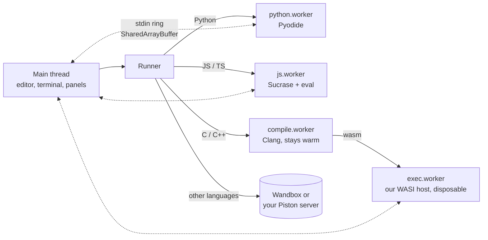

# Architecture

Bytepad is a static site with no backend. Everything below happens in the browser, except cloud languages.

## Source layout

| Path | Purpose |
| --- | --- |
| `src/core/` | Logic with no DOM, unit tested: projects, sharing, diagnostics, stdin, WASI, cloud requests |
| `src/workers/` | One Web Worker per engine |
| `src/runner.ts` | Starts engines, handles Stop and timeouts |
| `src/ui/`, `src/main.ts` | Interface |
| `public/sw.js` | Service worker: isolation headers and offline cache |
| `scripts/vendor-runtimes.mjs` | Copies Pyodide and Clang into `public/vendor/` at build time |

## Blocking input

A C program calling `scanf` expects the call not to return until input exists, but JavaScript can't normally
block. So programs run in a Web Worker, and input travels through a ring buffer in a `SharedArrayBuffer`
(`src/core/stdio.ts`). When the buffer is empty the worker sleeps in `Atomics.wait`. When you press Enter, the main
thread writes the line and calls `Atomics.notify`.

`SharedArrayBuffer` requires cross-origin isolation, which requires response headers GitHub Pages can't set. The
service worker adds them, so the first visit reloads the page once. Without isolation, such as after a hard
refresh, Bytepad falls back to pre-filled input from the Input tab.

## C and C++

[YoWASP Clang](https://github.com/YoWASP/clang) is real Clang and LLD compiled to WebAssembly. It runs in a worker
that stays alive between runs, because loading it is the slow part. The output is a WASI program, which runs in a
separate disposable worker so that Stop can terminate an infinite loop without losing the compiler.

`src/core/wasi.ts` is our own small WASI host. A custom one is needed so `fd_read` can block on stdin. It also
provides an in-memory filesystem.

The compiler gets one extra source file (`src/workers/clang-shims.ts`) that:

- turns off stdout buffering, because otherwise `printf("Enter: ")` stays invisible until after `scanf` returns
- defines the exception entry points that this libc++ build lacks, so that a `throw` explains itself rather than failing to link

## Python

[Pyodide](https://pyodide.org) runs in a worker that is reused between runs. Each run gets a fresh project
directory, `__main__` module and stdin wrapper.

The debugger uses `sys.settrace`. At each stop the tracer posts the stack and variables to the main thread, then sleeps
in `Atomics.wait` until a step command arrives through a second shared buffer.

## JavaScript and TypeScript

[Sucrase](https://github.com/alangpierce/sucrase) strips types and converts imports while keeping line numbers
intact. The code then runs in a fresh worker with `prompt`, `require`, `readline`, `fs` and `process` provided. The
run ends when the body has finished and no timers remain.

## Cloud languages

`src/core/cloud.ts` talks to [Wandbox](https://wandbox.org). Wandbox compiles the entry file under a fixed name
(`prog.java`), which rejects `public class Main`, so Java is sent with a small launcher class.

To keep code off third-party servers, run [Piston](https://github.com/engineer-man/piston) yourself, allow this
site's origin through CORS, and enter its URL under **Input > Self-hosted Piston server**. This path is covered by
unit tests of the request format only. It has not been tested against a live Piston server.

## Offline support

The service worker caches vendored runtimes on first use and precaches the app from `precache.json`, which is generated
at build time. Runtime caches are keyed by version, so upgrading a dependency replaces them.

## Share links

The project is JSON, then zlib compressed, then base64url encoded into the URL fragment. Browsers don't send
fragments to servers. Links are treated as untrusted: `sanitizeProject` validates everything, nothing runs until you
press Run, and your previous work can be restored.
